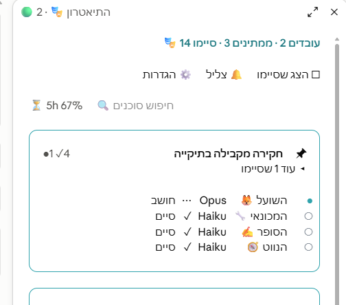

<!-- markdownlint-disable MD033 MD041 -->
<div align="center">

# 🎭 Claude Theater

**Watch your Claude Code conversations and subagents work — a live office, in real time.**

[](https://github.com/legalmindcode/claude-theater/actions/workflows/ci.yml)
[](https://pypi.org/project/claude-theater/)
[](https://pypi.org/project/claude-theater/)
[](LICENSE)

<!-- Absolute raw URL so the image renders on PyPI too (relative paths don't). -->


<sub>The demo office (`claude-theater --demo`): conversations and subagents at work, each agent walks in, sits, head-bobs while it types, then confetti on finish. A community visualizer **for Claude Code** — not affiliated with Anthropic.</sub>

</div>

Try it now, no Claude Code session required — `pipx run claude-theater --demo`
spins up the office above with synthetic agents.

**Why?** When you fan out a handful of subagents, the terminal becomes a wall of
interleaved JSON. Claude Theater turns it into a glance — who's working, who's
stuck, who just finished — without reading a single log line.

**Safe by design:** it runs entirely on your machine. Binds to `127.0.0.1`, sends
nothing anywhere (no telemetry), only *reads* the journals, and the whole thing is
one auditable standard-library file with zero dependencies. ([more](#privacy))

---

Claude Theater reads the journals Claude Code writes for your conversations and
the subagents they spawn, and renders them as a live office: **every conversation
is a room** (titled by its subject), and inside it the conversation itself plus
each subagent is a little character at a desk — avatar, name, the tool it's using
right now, and a timer. Click any character to read its full task and result.
When an agent finishes: confetti, a chime, and it quietly steps off the floor —
and each room has its own **show-finished** toggle, so you control the history
per conversation.

The UI is **bilingual** — English by default, Hebrew one click away (the choice
is remembered, and the layout flips to RTL). Adding another language is a single
edit to the `I18N` table in `claude_theater.py`; the server stays language-neutral.

## Claude desktop app mod

*New in 0.5.0.* If you work in the **Claude desktop app**, the office now lives
right inside its **Code tab**. `desktop-mod/` is a Claude Code plugin (a "mod")
that adds a **🎭 Theater** pane beside your chat — no browser tab, no server, no
separate install of the Python app.

<!-- Relative on purpose until the PNG is on main; swap in the absolute raw URL (like the images below) so it renders on PyPI too. -->



- **One framed card per open conversation**, titled by its subject, with **one row
  per subagent**: its persona, its model, what it's doing right now — and ✓ when
  it's finished (★ the moment it finishes, ✕ on a failure, ⏱︎ when it runs long) —
  calm monochrome marks in the Legal Mind teal, the personas in colour.
- **Click a row for its drawer** — the full task and the result, without leaving
  the chat.
- **Pin a conversation** (📌 on its title) to keep it at the top.
- **Show or hide the finished** — per conversation (`▸ 2 more finished`) or for
  the whole office with *Show finished*.
- **Search** shows up once the office gets large (more than 12 agents).
- **Hebrew and English**, one click apart; Hebrew flips the layout to RTL.
- **A 5-hour usage meter** in the office header and the status line, with a
  heads-up toast at 80% and 95% of the window.
- **A demo** — ⚙️ → *Demo* fills the office with synthetic agents, so you can look
  around without a single real subagent.
- It **opens itself** when your first subagent starts (or run `/theater`), and a
  finish gets a short toast naming the conversation plus a chime (mute with 🔔).
- In a terminal, VS Code or mobile session the same pane draws as **text cards**.

**Keys** (with the pane focused): `j`/`k` walk the rows · `o`/`Enter` open ·
`x` close · `f` show finished · `m` mute · `h` settings · `l` language · `d` demo.

### Install

In the Claude desktop app, where `/plugin` doesn't run: click **+** next to the
prompt box → **Plugins** → **Add marketplace** → `legalmindcode/claude-theater`
→ **Add plugin** → `agent-theater`.

Or in a terminal Claude Code session:

```text
/plugin marketplace add legalmindcode/claude-theater
/plugin install agent-theater@claude-theater
```

(The marketplace is this repository's own `.claude-plugin/marketplace.json`.
`/plugin install` opens the plugin's details; pick the user scope and it loads in
the desktop app's local sessions too. From a plain shell the same two steps are
`claude plugin marketplace add legalmindcode/claude-theater` and
`claude plugin install agent-theater@claude-theater`.)

**Requires** the Claude desktop app's Code tab and **Claude Code 2.1.304 or newer**.
The mod is built on Claude Code's early-access function-hooks API, which may
change between releases — if a Claude Code update breaks the mod, please open an
issue here. Developed and tested on 2.1.304–2.1.308.

**Privacy.** It only reads your local Claude Code transcripts (`~/.claude/projects`,
plus the open-conversations registry in `~/.claude/sessions`); the only file of its
own it reads is its small logo, which ships in the mod's folder. It writes nothing
outside its own settings (language, sound, pins), makes **no network calls** and
sends no telemetry. For transcripts too big to read directly it runs local
read-only helpers (`head`/`tail`/`ps`, or PowerShell and `tasklist` on Windows).

## Screenshots

<!-- Absolute raw URLs so the images render on PyPI too (relative paths don't). -->

**Your real sessions** — every conversation is a room; the conversation itself and
each subagent is a character at a desk (avatar, name, the tool it's using now, a timer).


**Bilingual — English ⇄ Hebrew (RTL).** One click flips the whole office; the choice
is remembered and the layout switches to RTL.

| English | Hebrew (RTL) |
| :--: | :--: |
|  |  |

**Try it with no session — `claude-theater --demo`** spins up the office with synthetic agents.


## Quick start

Zero install — run it straight from PyPI with [pipx](https://pipx.pypa.io/):

```bash
pipx run claude-theater          # watches your real Claude Code sessions
pipx run claude-theater --demo   # a synthetic, populated office — no sessions needed
```

New here? Start with `--demo` to look around before pointing it at your own work.

Or install it:

```bash
pipx install claude-theater   # or: pip install claude-theater
claude-theater                # add --demo for the synthetic office
```

Or run from a clone (pure standard library, nothing to install):

```bash
python -m claude_theater
```

Then open **http://localhost:7333**. The server opens your browser for you — pass
`--no-browser` to skip that (handy on a headless box or inside an editor panel).
On Windows, from a clone, you can also just run `start.cmd`.

> Requires Python 3.9+. The non-demo mode reads the journals a Claude Code
> install writes under `~/.claude/projects/`; `--demo` needs nothing but Python.

## VS Code extension

Prefer it inside your editor? The `vscode-extension/` folder packages Claude
Theater as a VS Code extension: it starts the server in the background (toggle it
from a status-bar button) and opens the office in an interactive panel — no
separate terminal. The server is bundled into the extension, so it works without
a separate install, and it auto-starts when VS Code launches.

**Install the prebuilt `.vsix`** (easiest) — download
`claude-theater-<version>.vsix` from the
[latest release](https://github.com/legalmindcode/claude-theater/releases/latest),
then in VS Code run **Extensions: Install from VSIX…**, or from a terminal:

```bash
code --install-extension claude-theater-<version>.vsix
```

**Or build it from source** (needs Node.js):

```bash
git clone https://github.com/legalmindcode/claude-theater
cd claude-theater/vscode-extension
npx @vscode/vsce package        # produces claude-theater-<version>.vsix
code --install-extension claude-theater-*.vsix
```

## Auto-start with Claude Code

The VS Code extension already starts the server on launch. If you use the CLI,
the recommended one-time setup is a `SessionStart` hook in your
`~/.claude/settings.json`, so the office comes up by itself whenever you begin a
Claude Code session. Each user adds it once. (Heads-up: this leaves an
unauthenticated loopback endpoint running in the background — see [Privacy](#privacy).)

<details>
<summary><b>macOS / Linux / Git Bash</b></summary>

```json
{
  "hooks": {
    "SessionStart": [
      { "hooks": [ { "type": "command",
        "command": "curl -sf http://127.0.0.1:7333/ -o /dev/null || (claude-theater --no-browser &)" } ] }
    ]
  }
}
```

</details>

<details>
<summary><b>Windows (PowerShell)</b></summary>

```json
{
  "hooks": {
    "SessionStart": [
      { "hooks": [ { "type": "command",
        "command": "powershell -NoProfile -Command \"if(-not(Get-NetTCPConnection -LocalPort 7333 -State Listen -ErrorAction SilentlyContinue)){Start-Process -WindowStyle Hidden -FilePath claude-theater -ArgumentList '--no-browser'}\"" } ] }
    ]
  }
}
```

</details>

Both check the port first, so they stay idempotent. (Requires `claude-theater`
on your `PATH`, e.g. via `pipx install claude-theater`.)

## How it works

- Polls the journals Claude Code already writes — both the session files (your
  conversations) and `**/subagents/agent-*.jsonl` (the subagents they spawn).
  Claude Theater only reads them; it never starts or controls agents.
- A single adapter, `parse_agent_event(line) -> Event`, is the **only** code
  that touches the raw journal format. Everything else consumes the stable
  `Event`, so a Claude Code format change is absorbed in one place.
- **Degrades, never crashes:** corrupt lines are skipped (and counted), unknown
  keys are ignored, and an agent missing fields still shows up instead of
  vanishing.
- A non-blocking **version banner** appears when a journal comes from a Claude
  Code version this build hasn't been tested against — output may be partial,
  but the office keeps running.

## Privacy

Your journals contain real conversation content, so Claude Theater is built to
keep them on your machine:

- Binds to **`127.0.0.1` only** — never reachable from the network, with a
  loopback `Host` allowlist that blocks DNS-rebinding.
- **Never transmits** anything anywhere. No telemetry, no remote calls.
- **Read-only** — it opens journals to read, never to write.
- A strict `Content-Security-Policy` and `X-Content-Type-Options: nosniff`, and
  cross-origin headers sent **only** to a `vscode-webview://` origin, so an
  ordinary web page can't read your agents.
- The committed `fixtures/` are 100% synthetic — no real prompts or results.

The local endpoint is **unauthenticated**: any process running as you on this
machine can read it — the same trust boundary as the journal files themselves.
The auto-start hook above leaves that endpoint up in the background.

## Development

```bash
python -m unittest discover -s tests   # golden parser tests, zero dependencies
```

The tests run synthetic journal fixtures through the adapter and fail loudly if
the format drifts. Contributing a journal sample from a new Claude Code build is
the most valuable contribution — **scrub every prompt and result first.**

## Compatibility

Tested against Claude Code **2.1.x**. Newer builds will trigger the version
banner; please open a *format-drift report* with a scrubbed sample so we can add
a fixture and an adapter case.

## License

[MIT](LICENSE) © 2026 Asaf Abramzon. "Claude" is a trademark of Anthropic;
this is an independent, community project for Claude Code.
